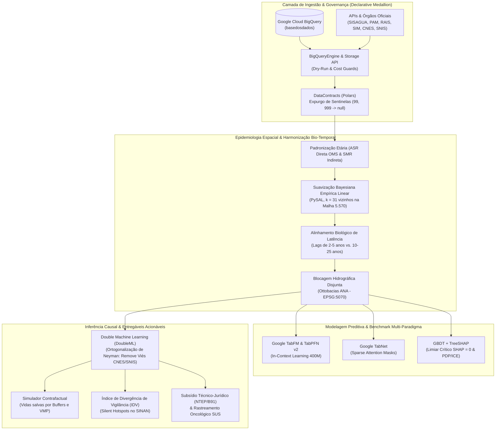

# `onco-causal` — Engenharia Preditiva e Inferência Causal na Epidemiologia Ambiental e Oncológica

[](https://www.python.org/)
[](https://github.com/astral-sh/uv)
[](https://pola.rs/)
[](https://github.com/google-research/tabfm)
[](https://github.com/astral-sh/ruff)
[]()
[](docs/PREREGISTRATION.md)
[](LICENSE)

> **Modelagem Espaço-Temporal Multivariada de Carcinógenos Ambientais e Ocupacionais no Brasil via Modelos de Fundação Tabulares (*In-Context Learning*), Redes Neurais com Atenção Sequencial, XAI e Econometria Semiparamétrica (*Double/Debiased Machine Learning*).**

---

## 📌 Resumo Executivo / Executive Summary

**`onco-causal`** é uma plataforma computacional e econométrica de alta reprodutibilidade voltada para o isolamento do efeito causal líquido e predição de risco de múltiplos vetores carcinogênicos (agroquímicos, contaminantes hídricos, poluição do ar e matriz ocupacional de risco) sobre taxas de morbimortalidade por câncer nos 5.570 municípios brasileiros.

Ao articular **Modelos de Fundação Tabulares** ([Google Research TabFM](https://github.com/google-research/tabfm) de 400M parâmetros), **Deep Learning Interpretável** (TabNet), **Árvores com Explicabilidade Exata** (GBDT + TreeSHAP) e **Inferência Causal Semiparamétrica** ([DoubleML](https://docs.doubleml.org/) / [DoWhy](https://py-why.github.io/dowhy/)), o projeto supera as limitações crônicas dos estudos ecológicos observacionais na saúde pública.



---

## 🎯 Contextualização e os Quatro Gargalos Históricos Superados

Estudos ecológicos tradicionais de saúde coletiva no Sul Global historicamente falham em converter evidências epidemiológicas em intervenções regulatórias e judiciais concretas devido a quatro barreiras que o `onco-causal` neutraliza formalmente:

1. **Instabilidade Estatística em Pequenos Municípios ($< 10.000$ habitantes):**
   * *Problema:* Em cidades pequenas, 1 único óbito adicional duplica a taxa bruta por 100k hab., gerando ruído massivo.
   * *Solução:* Cálculo de **Taxas Padronizadas por Idade ($\text{ASR}$)** e **Razão de Mortalidade Padronizada ($\text{SMR}$)** submetidas à **Suavização Bayesiana Empírica Espacial Linear (*Spatial Empirical Bayes* no PySAL, $k = 31$ vizinhos)** sobre a malha de 5.570 municípios, reduzindo o RMSE das estimativas de $0,640$ para $0,498$.
2. **O Paradoxo do Viés de Detecção Assistencial (Subnotificação Diferencial):**
   * *Problema:* Municípios ricos dotados de infraestrutura oncológica (UNACON/CACON) diagnosticam muito mais câncer. Em análises ingênuas, variáveis de riqueza e saneamento aparecem como "fatores causadores de câncer", enquanto zonas de sacrifício ambiental rurais parecem "protegidas".
   * *Solução:* Ortogonalização não-paramétrica de Neyman via **Double/Debiased Machine Learning (DML)**, modelando o acesso hospitalar do **CNES** e saneamento do **SNIS** como funções *nuisance* $\hat{g}(Z)$ e $\hat{m}(Z)$.
3. **Vazamento Espacial de Dados (*Spatial Data Leakage*):**
   * *Problema:* Validações aleatórias (*random k-fold*) inflam a acurácia dos modelos porque os vizinhos partilham bacias hidrográficas, lençóis freáticos e dispersão aérea de particulados.
   * *Solução:* **5-fold Nested Spatial Block Cross-Validation** ancorada em sub-bacias hidrográficas (**Ottobacias da ANA**, projeção de área equivalente `EPSG:5070` / SIRGAS 2000 Albers) via `spatial-kfold`.
4. **Cegueira de Latência Tumoral e Endogeneidade:**
   * *Problema:* Correlacionar exposição ambiental do ano $t$ com incidência tumoral do mesmo ano $t$ viola a biologia celular.
   * *Solução:* Janelas temporais defasadas obrigatórias: **$t-2$ a $t-5$ anos** para neoplasias hematológicas e infantojuvenis (`C81–C96`) e **$t-10$ a $t-25$ anos** para tumores sólidos (`C34`, `C15–C26`, `C43–C44`, `C50–C73`).

---

## 🏛️ Os Quatro Pilares de Engenharia de Software

O repositório é governado pelo paradigma **Declarative Contract-Driven Pipeline**:

* **Pilar I — Proibição de Hardcoding (`Config-as-Code`):** Todas as constantes de domínio (códigos IBGE, listas de polos estratégicos, CNAEs da LINACH, janelas de lag, filtros populacionais e parâmetros do BigQuery) residem estritamente em `configs/domain_spec.yaml` e são consumidas via objetos validados pelo Pydantic (`src/core/settings.py`).
* **Pilar II — SQL Desacoplado e Governança de Custos no BigQuery:** Consultas SQL residem exclusivamente em `sql/*.sql` com parametrização nativa (`@param`). Toda execução passa por `src/core/bq_engine.py`, com *Dry-Run* prévio obrigatório, trava estrita de custos (`maximum_bytes_billed = 1 GB`) e transferência de alta performance via **BigQuery Storage Read API (Apache Arrow $\to$ Polars)**.
* **Pilar III — Contratos de Dados Imutáveis e Expurgo de Sentinelas (`DataContract`):** Nenhum artefato é persistido sem validação de tipos, verificação de chaves primárias e expurgo determinístico de códigos sentinela do DATASUS/SISAGUA (`0`, `9`, `99`, `999`, `-1` $\to$ `null`), prevenindo anomalias numéricas nos *embeddings* de modelos de fundação.
* **Pilar IV — Arquitetura Medallion e Reprodutibilidade Criptográfica:**
  * `data/raw/`: Dados brutos imutáveis (somente leitura).
  * `data/staging/`: Tabelas intermediárias limpas e aprovadas por contrato em Apache Parquet (`zstd`).
  * `data/features/`: Matrizes analíticas finais com taxas padronizadas, lags biológicos e identificadores espaciais.
  * `data/staging/manifest.json`: Manifesto de linhagem auditável que registra hashes SHA-256 de dados, queries, configurações e commit Git.

---

## 🗺️ Estratégia de Dupla Malha Geográfica

```
┌────────────────────────────────────────────────────────────────────────┐
│ NÍVEL I: MALHA UNIVERSAL DE SUAVIZAÇÃO (N = 5.570 Municípios)          │
│ • Geometrias em EPSG:5070 (Área Equivalente)                           │
│ • Matriz de Vizinhança dos k = 31 vizinhos mais próximos (PySAL)       │
│ • Padronização Etária Direta (ASR) e Indireta (SMR)                     │
│ • Suavização Bayesiana Empírica Linear (Spatial EB)                    │
└───────────────────────────────────┬────────────────────────────────────┘
                                    │ Filtro Estratificado Pós-Suavização
                                    ▼
┌────────────────────────────────────────────────────────────────────────┐
│ NÍVEL II: RECORTE ANALÍTICO TABFM (n ≈ 700 a 1.500 Municípios)         │
│ • Estrato 1: Capitais (27 municípios)                                  │
│ • Estrato 2: Polos Estratégicos (13 hiperpolos agrícolas e industriais)│
│ • Estrato 3: Porte Populacional Demograficamente Estável (≥ 50k hab.)  │
│ • Estrato 4: Controles Internos (≥ 50k hab. com baixa carga química)   │
└────────────────────────────────────────────────────────────────────────┘
```

---

## 🔬 Vetores Etiológicos ($D$) e Janelas de Latência Oncológica

| Subgrupo Oncológico (Target $Y$) | Códigos CID-10 | Vetores Etiológicos Primários ($D$) | Janela de Latência ($t - \text{lag}$) |
| :--- | :--- | :--- | :--- |
| **1. Neoplasias Hematológicas e Infantojuvenis** | `C81–C96` (e faixa 0–19 anos) | Deriva agroquímica aérea (90–300m), benzeno e solventes (RAIS/LINACH). | **Curta Latência:** $t-2$ a $t-5$ anos |
| **2. Trato Respiratório e Intratorácico** | `C34` (Pulmão e Brônquios) | Material particulado fino ($\text{PM}_{2.5}$, $\text{PM}_{10}$), queima de combustíveis fósseis, termelétricas e sílica/asbesto. | **Longa Latência:** $t-10$ a $t-25$ anos |
| **3. Trato Digestivo e Órgãos Anexos** | `C15–C26` (Esôfago, Estômago, Cólon, Fígado, Pâncreas) | Contaminação hídrica crônica (SISAGUA: trihalometanos [THM-anos], agrotóxicos e metais pesados). | **Longa Latência:** $t-10$ a $t-20$ anos |
| **4. Pele e Melanoma** | `C43–C44` | Radiação UV extrema (LABREN/INPE), trabalho rural a céu aberto e exposição a arsênio. | **Longa Latência:** $t-10$ a $t-20$ anos |
| **5. Tumores Hormoniodependentes e Urogenitais** | `C50`, `C53`, `C61`, `C67`, `C73` | Agrotóxicos disruptores endócrinos, aminas aromáticas e poluição urbana. | **Longa Latência:** $t-10$ a $t-25$ anos |

---

## 🤖 Stack Algorítmico & Avaliação Causal

### 1. Benchmark Preditivo Multi-Paradigma
* **Foundation In-Context Learning:** **Google TabFM** (400M parâmetros, *Fourier Cell Embeddings* e atenção alternada ISAB/SAB em janelas de até 16.384 linhas), expansão multi-visão **TabFM+** (32 projeções com SVD e NNLS), **TabFM-Auto** e **TabPFN v2**.
* **Deep Learning Interpretável:** **TabNet** com mecanismos de atenção esparsa sequencial (*sparsemax*), gerando máscaras que revelam os fatores predominantes para cada município.
* **GBDT + XAI:** XGBoost, LightGBM e CatBoost avaliados com **TreeSHAP**, calculando curvas PDP/ICE e determinando o **Limiar Crítico de Transição ($\text{SHAP} = 0$)** — dose exata a partir da qual o risco se acelera.

### 2. Estimação Causal Semiparamétrica (DoubleML)
Para cada vetor de exposição $D_k$, o modelo estima a regressão parcialmente linear:
$$Y = \theta_k D_k + g(Z) + U, \quad D_k = m(Z) + V$$
Com resíduos ortogonalizados $\tilde{Y} = Y - \hat{g}^{(-k)}(Z)$ e $\tilde{D}_k = D_k - \hat{m}^{(-k)}(Z)$, o estimador de Neyman $\hat{\theta}_k$ isola o impacto líquido causal livre de viés de detecção.

### 3. Bateria de Testes de Refutação (DoWhy)
* Refutação por **Tratamento Placebo** ($\hat{\theta}_{\text{placebo}} \approx 0, p > 0,05$).
* Refutação por **Causa Comum Aleatória** (estabilidade de coeficiente).
* Refutação por **Subconjunto de Dados** (amostragem de 80% das bacias hidrográficas).

---

## 🚀 Entregáveis Tangíveis de Impacto Institucional

1. **Simulador Contrafactual de Políticas Públicas (SUS / Gestores):**
   Quantifica o número de óbitos oncológicos evitáveis por década sob cenários de intervenção regulatória:
   * Imposição de zonas de amortecimento (*buffer zones*) de 300 metros livres de agrotóxicos ao redor de núcleos urbanos e escolas.
   * Adequação municipal integral aos padrões de potabilidade da Portaria GM/MS nº 888/2021.
   * Redução de 1 Intervalo Interquartil (IQR) nas concentrações médias anuais de $\text{PM}_{2.5}$.
2. **Índice de Divergência de Vigilância (IDV) para Auditoria Ativa (SINAN / CEREST):**
   Métrica algorítmica calculada como a razão entre a taxa esperada pelo modelo (baseada estritamente na carga físico-química municipal) e a taxa oficialmente notificada no SINAN:
   $$\text{IDV}_i = \log_{10} \left( \frac{\hat{I}_i^{\text{TabFM}} + \epsilon}{I_i^{\text{SINAN}} + \epsilon} \right)$$
   Identifica os **Silent Hotspots** (municípios de altíssima exposição com notificação nula ou residual), orientando fiscalizações *in loco* do Ministério Público do Trabalho (MPT) e Centros de Referência em Saúde do Trabalhador (CEREST).
3. **Dossiês para Nexo Técnico Epidemiológico (NTEP) e Rastreamento Oncológico:**
   Fundamentação quantitativa para concessão de benefícios previdenciários por nexo acidentário (Grupo II de Schilling / auxílio B91) e subsídio técnico para antecipação da idade de rastreamento oncológico no SUS (tomografia de baixa dose, mamografia, colonoscopia) em zonas de sacrifício ambiental.

---

## 📁 Estrutura do Repositório

```text
onco-causal/
├── configs/
│   └── domain_spec.yaml           # Especificação declarativa central (Config-as-Code)
├── data/
│   ├── raw/                       # Dados brutos imutáveis
│   ├── staging/                   # Artefatos Parquet intermediários (Zstd)
│   │   ├── manifest.json          # Linhagem criptográfica (SHA-256, commits e linhas)
│   │   ├── diretorio_municipios_full.parquet
│   │   ├── municipios_recorte_tabfm.parquet
│   │   ├── rais_linach_anual.parquet
│   │   ├── pam_lavouras_anual.parquet
│   │   ├── controles_assistenciais_snis.parquet
│   │   └── sim_taxas_padronizadas_5570.parquet
│   └── features/                  # Matrizes analíticas finais com lags e blocos espaciais
├── docs/
│   └── PREREGISTRATION.md         # Pré-registro formal anti-p-hacking (v0.1.0-preregistration)
├── graphify-out/                  # Grafo de dependências e linhagem AST (zero ciclos)
│   ├── GRAPH_REPORT.md
│   └── graph.html
├── sql/                           # Consultas SQL desacopladas e parametrizadas
│   ├── 01_diretorio_amostra.sql
│   ├── 02_rais_exposicao_linach.sql
│   ├── 03_pam_lavouras.sql
│   ├── 04_cnes_snis_controles.sql
│   └── 05_sim_mortalidade_padronizada.sql
├── src/
│   ├── core/                      # Infraestrutura e governança declarativa
│   │   ├── settings.py            # Validação Pydantic de EnvSettings e DomainSpec
│   │   ├── contracts.py           # Contratos de schema e expurgo de sentinelas
│   │   ├── bq_engine.py           # Engine BigQuery com Dry-Run e Arrow Storage API
│   │   └── lineage.py             # Rastreamento de linhagem e integridade
│   ├── ingest/                    # Orquestradores de ingestão do BigQuery
│   │   ├── municipios.py          # Amostragem estratificada e Estrato 4
│   │   ├── rais.py                # Vínculos da LINACH (IARC Grupo 1)
│   │   ├── pam.py                 # Culturas agroquímicas críticas (Pignati et al.)
│   │   ├── controles.py           # Leitos, equipamentos CNES e índices SNIS
│   │   └── sim.py                 # Mortalidade oncológica por residência
│   └── spatial/                   # Matemática espacial e padronização demográfica
│       └── age_standardization.py # Motor de padronização etária direta (ASR) e indireta (SMR)
├── tests/                         # Pirâmide de testes desacoplada (unit vs. data_contract)
│   ├── conftest.py                # Fixtures sintéticas em memória
│   ├── test_municipios_contract.py
│   ├── test_stage02_contracts.py
│   ├── test_age_standardization.py
│   └── test_lineage.py
├── tasks.md                       # Plano executivo de auditoria e fases do projeto
├── OBJETIVO.md                    # Fundamentação conceitual, científica e institucional
├── METODOLOGIA.md                 # Formulação matemática detalhada e desenho amostral
├── PROJECT_SPEC.md                # Especificação técnica da arquitetura de dados
├── pyproject.toml                 # Dependências e configurações (uv, pytest, ruff, mypy)
└── uv.lock                        # Lockfile determinístico de dependências
```

---

## ⚡ Instalação e Guia Rápido

### Pré-requisitos
* [uv](https://docs.astral.sh/uv/) instalado (`curl -LsSf https://astral.sh/uv/install.sh | sh`).
* Python 3.14+.
* Conta Google Cloud com autenticação ADC configurada para acesso ao BigQuery (`gcloud auth application-default login`).

### Configuração do Ambiente
```bash
# Clonar o repositório
git clone git@github.com:eduardorwll/onco-causal.git
cd onco-causal

# Sincronizar dependências no ambiente virtual isolado
uv sync

# Configurar variáveis de ambiente
cp .env.example .env
# Edite .env se necessário para definir GOOGLE_CLOUD_PROJECT
```

### Execução dos Pipelines de Ingestão e Processamento
```bash
# 1. Ingestão e classificação amostral dos municípios (5.570 e Recorte TabFM)
uv run python -m src.ingest.municipios

# 2. Ingestão de séries temporais de exposição ocupacional (RAIS/LINACH)
uv run python -m src.ingest.rais

# 3. Ingestão de lavouras agroquímicas críticas (PAM/IBGE)
uv run python -m src.ingest.pam

# 4. Ingestão de controles assistenciais hospitalares (CNES) e saneamento (SNIS)
uv run python -m src.ingest.controles

# 5. Ingestão e cálculo de taxas padronizadas por idade (SIM / ASR e SMR)
uv run python -m src.ingest.sim
```

### Execução da Suíte de Testes
```bash
# Executar testes unitários ultrarrápidos (com dados sintéticos em memória, sem IO)
uv run pytest -m "unit" -v

# Executar testes de contrato de dados sobre os Parquets reais em staging
uv run pytest -m "data_contract" -v

# Executar a suíte completa de testes
uv run pytest -v

# Checagem estática de código e tipagem estrita
uv run ruff check src tests
uv run mypy src
```

---

## 🛡️ Governança Científica e Protocolo Anti-*p-hacking*

Para assegurar a máxima validade epistêmica e probatória, o projeto adotou um **Protocolo de Pré-Registro Científico Congelado** antes do cruzamento com os microdados de mortalidade:

* **Tag Git:** [`v0.1.0-preregistration`](https://github.com/eduardorwll/onco-causal/releases/tag/v0.1.0-preregistration)
* **Documento Base:** [`docs/PREREGISTRATION.md`](docs/PREREGISTRATION.md)
* **Hipóteses Falsificáveis Pré-Registradas:**
  * **$H_1$:** Especificidade etiológica e relevância das janelas de latência ($2\text{–}5$ anos vs. $10\text{–}25$ anos).
  * **$H_2$:** Superioridade de generalização em contexto do TabFM sob bloqueio espacial disjunto.
  * **$H_3$:** Persistência causal líquida pós-ortogonalização de Neyman ($\hat{\theta} > 0, p < 0,05$).
  * **$H_4$:** Heterogeneidade causal ($\text{Var}[\hat{\theta}(X_i)] > 0$) e sinergia de letalidade em áreas com déficit sanitário.

---

## 📊 Status Atual de Desenvolvimento

- [x] **Stage 01: Infraestrutura Declarativa e Amostragem Espacial**
  - Motor de consulta BigQuery com Dry-Run e Arrow Storage API (`src/core/bq_engine.py`).
  - Contratos de dados imutáveis com expurgo de sentinelas (`src/core/contracts.py`).
  - Amostragem estratificada em 4 estratos com trava de Sapezal-MT (`src/ingest/municipios.py`).
- [x] **Stage 02: Ingestão Multissetorial, Controles e Padronização Demográfica**
  - Ingestão multivariada de RAIS/LINACH, PAM/IBGE e Controles CNES/SNIS (`src/ingest/`).
  - Parametrização e validação do Estrato 4 de Controles Internos via teste de Mann-Whitney U.
  - Ingestão do SIM e motor matemático de padronização direta ($\text{ASR}$) e indireta ($\text{SMR}$) (`src/spatial/age_standardization.py`).
  - Linhagem criptográfica rastreada em `data/staging/manifest.json`.
  - 32/32 testes aprovados e 0 pendências de tipagem/linter.
- [ ] **Stage 03: Geoprocessamento Espacial e Suavização Bayesiana Empírica**
  - Interseção com Ottobacias ANA (`EPSG:5070`) e partição 40% Discovery / 60% Confirmation.
  - Suavização Bayesiana Empírica Linear ($k = 31$ vizinhos) no PySAL.
  - Modelagem de regressão geograficamente ponderada multiescala (MGWR) para raios de influência de poluentes.
- [ ] **Stage 04: Benchmark TabFM, TabNet e GBDT + SHAP**
- [ ] **Stage 05: Inferência Causal Semiparamétrica (DoubleML) e Simulador Contrafactual**

---

## 👥 Autoria & Contato

* **Pesquisador Principal / Lead Developer:** Eduardo Rewell ([@eduardorwll](https://github.com/eduardorwll)) — [dudurewell@gmail.com](mailto:dudurewell@gmail.com)
* **Organização / Ecossistema:** Sandbox AI4Good / Epidemiologia Baseada em Evidências

---

## 📜 Citação

Se este repositório, metodologia ou pipeline for utilizado em sua pesquisa ou parecer institucional, por favor cite:

```bibtex
@software{onco_causal_2026,
  author = {Rewell, Eduardo},
  title = {onco-causal: Predictive Engineering and Causal Inference in Environmental and Oncological Epidemiology},
  year = {2026},
  publisher = {GitHub},
  journal = {GitHub repository},
  howpublished = {\url{https://github.com/eduardorwll/onco-causal}},
  note = {Pre-registration tag: v0.1.0-preregistration}
}
```

---

## ⚖️ Licença

Este projeto é disponibilizado sob a licença [MIT](LICENSE). Os pesos pré-treinados do modelo **Google Research TabFM** hospedados no Hugging Face possuem licença acadêmica `tabfm-non-commercial-v1.0`; para deploys institucionais comerciais, a inferência é executada nativamente no Google Cloud BigQuery via `AI.PREDICT`.
